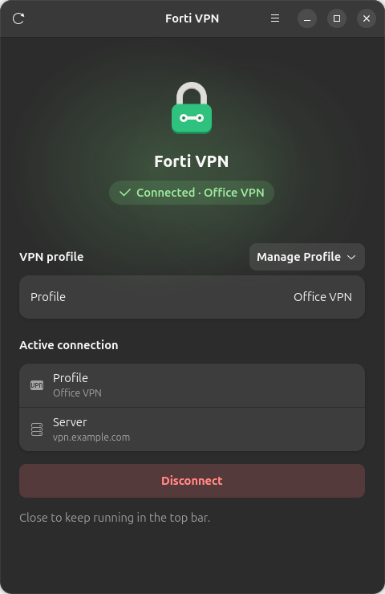
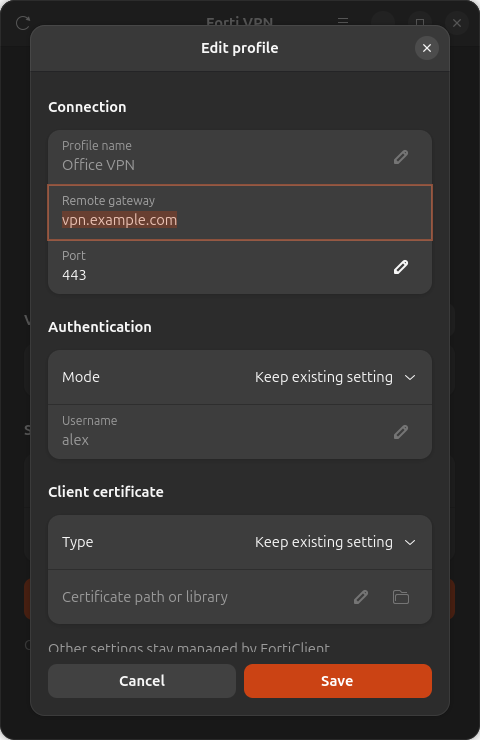
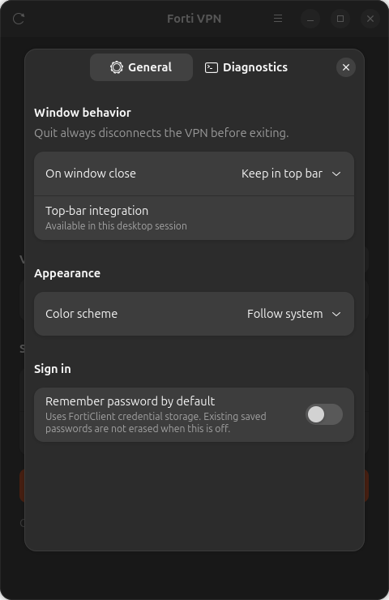
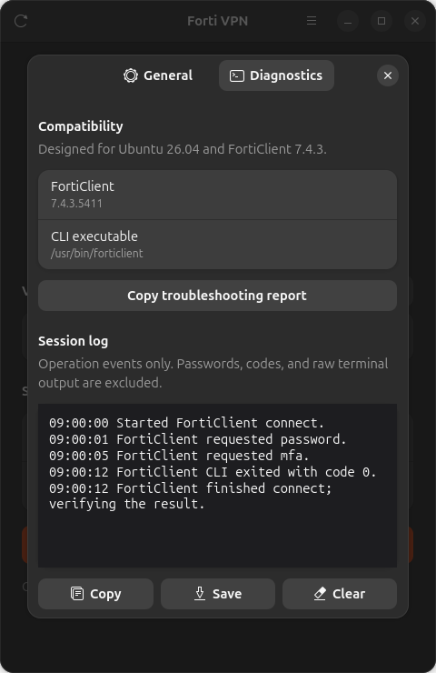

# Forti-VPN

A lightweight, unofficial Ubuntu GUI for FortiClient VPN, with connection control, profile management, and top-bar integration.

## Features

- Connect and disconnect with password and MFA support.
- Create, view, edit, and delete VPN profiles.
- Keep the app in the top bar when closing.
- Choose light, dark, or system appearance.
- View and copy session diagnostics.
- Select certificate files and copy a troubleshooting report.

## Install

Built for Ubuntu 26.04 and FortiClient 7.4.3. If the CLI is missing, the app guides you through setup.

Download the `.deb` from [Releases](https://github.com/othman2408/forti-vpn/releases) and install it:

```bash
sudo apt install ./forti-vpn_0.1.0_all.deb
```

Or install from source:

```bash
sudo apt install python3 python3-gi gir1.2-gtk-4.0 gir1.2-adw-1

git clone https://github.com/othman2408/forti-vpn.git
cd forti-vpn
./scripts/install.sh
```

Open **Forti VPN** from your applications menu. Use **Set Up FortiClient** if needed; installation commands are copied for you to run in Terminal. Run the installer again after updating the source.

## Use

- Select a profile, click **Connect**, and enter your password or MFA code when prompted.
- Use **Manage Profile** to create, view, edit, or delete profiles.
- Use **Manage Profile → Update Saved Password** to reconnect with a new saved login password.
- Open **Settings** for preferences and diagnostics.
- Click **Refresh** to update profiles and connection status.

Closing the window keeps the app in the top bar. Use **Disconnect and Quit** to exit, or change this behavior in Settings. Top-bar integration requires AppIndicator support.

The app never stores passwords or MFA codes; saved passwords are managed by FortiClient.

## Screenshots

Captured from the app using demo data and a simulated connection.

| Connection | Profile editor |
| :---: | :---: |
|  |  |

| Settings | Diagnostics |
| :---: | :---: |
|  |  |

## License

Code, documentation, and original icons are licensed under [MIT](LICENSE). FortiClient is installed separately and remains subject to Fortinet's terms. See [NOTICE](NOTICE).
