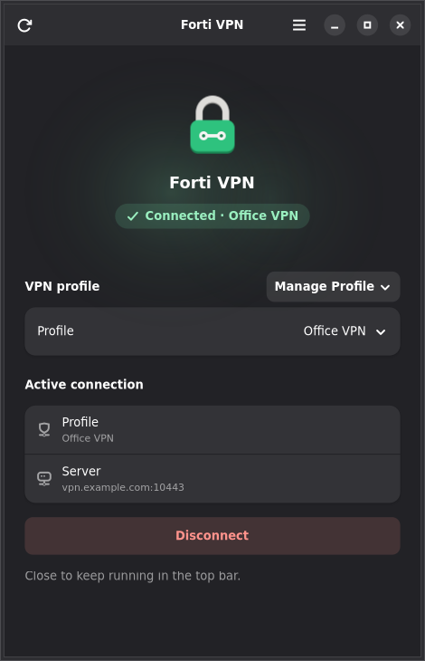
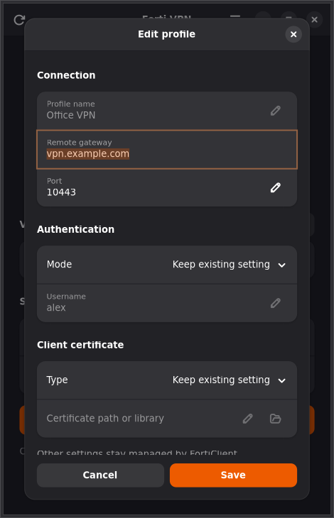
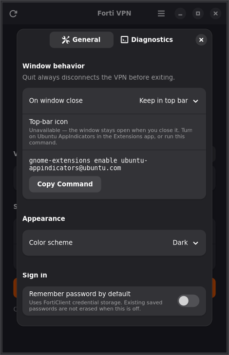
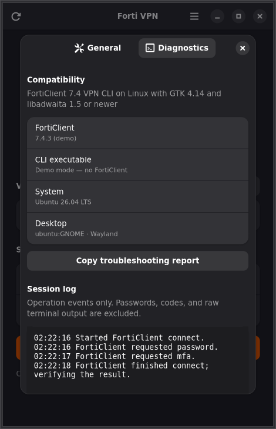

# Forti-VPN

A lightweight, unofficial Linux desktop app for FortiClient VPN, with connection control, profile management, and tray integration. Built with Rust, GTK 4, and libadwaita.

## Features

- Connect and disconnect with password and MFA support.
- Create, view, edit, and delete VPN profiles.
- Keep the app in the tray when closing, with an icon that shows the connection.
- Choose light, dark, or system appearance.
- View and copy session diagnostics.
- Select certificate files and copy a troubleshooting report.
- Get FortiClient setup steps for your distribution.

## Supported distributions

The app needs GTK 4.14 and libadwaita 1.5 or newer. The table shows the GTK and libadwaita versions these releases ship.

| Distribution | GTK | libadwaita | Package |
| --- | --- | --- | --- |
| Ubuntu 24.04 LTS | 4.14.5 | 1.5.0 | `.deb` |
| Ubuntu 26.04 LTS | 4.22.4 | 1.9.1 | `.deb` |
| Debian 13 | 4.18.6 | 1.7.6 | `.deb` |
| Fedora 45 (Fedora 43 and 44 ship GTK 4.20 and 4.22) | 4.24.1 | 1.10.0 | `.rpm` |
| AlmaLinux, Rocky Linux, RHEL 10 | 4.16.7 | 1.6.10 | `.rpm` |
| openSUSE Leap 16 | 4.18.6 | 1.7.5 | `.rpm` |
| openSUSE Tumbleweed | 4.24.1 | 1.10.0 | `.rpm` |
| Arch Linux | 4.24.1 | 1.10.0 | `.pkg.tar.zst`, PKGBUILD |

Distributions based on these releases, such as Linux Mint 22, Pop!\_OS 24.04, Manjaro, and EndeavourOS, use the same packages but are not tested. Ubuntu 22.04, Debian 12, RHEL 9 and its rebuilds, and openSUSE Leap 15 ship older GTK and libadwaita and are not supported.

## Install

Download a package from [Releases](https://github.com/othman2408/forti-vpn/releases) and install it. FortiClient is installed separately (see below); if its CLI is missing, the app guides you through setup.

Ubuntu and Debian:

```bash
sudo apt install ./forti-vpn_0.2.0-1_amd64.deb
```

Fedora, RHEL, AlmaLinux, and Rocky Linux:

```bash
sudo dnf install ./forti-vpn-0.2.0-1.el10.x86_64.rpm
```

The release packages are not signed. dnf installs them with a warning that it skipped the OpenPGP check; on Fedora 45, `rpm -i` refuses them unless you add `--nosignature`. On openSUSE, zypper needs `--allow-unsigned-rpm`:

```bash
sudo zypper install --allow-unsigned-rpm ./forti-vpn-0.2.0-1.el10.x86_64.rpm
```

Arch Linux: install the release package:

```bash
sudo pacman -U ./forti-vpn-0.2.0-1-x86_64.pkg.tar.zst
```

To build it yourself, use [`packaging/arch/PKGBUILD`](packaging/arch/PKGBUILD). It cannot hold the checksum of the release tarball, which contains it, so it skips the check (`sha256sums=('SKIP')`). Run `updpkgsums` (from pacman-contrib) to fill it in, and before building, check that it matches the line for `forti-vpn-0.2.0.tar.gz` in the release's `SHA256SUMS`:

```bash
cd packaging/arch
updpkgsums
grep '^sha256sums' PKGBUILD
makepkg -si
```

Flatpak (experimental, not on Flathub): the bundle runs FortiClient on the host through `flatpak-spawn --host`, a deliberate sandbox escape, so it is no more contained than the native package.

```bash
flatpak install --user ./io.github.fortivpn.Utility.flatpak
```

Open **Forti VPN** from your applications menu. Check downloads with `sha256sum -c --ignore-missing SHA256SUMS`.

### From source

Install Rust 1.92 or newer and the build dependencies:

| Distribution | Command |
| --- | --- |
| Ubuntu, Debian | `sudo apt install build-essential pkg-config libgtk-4-dev libadwaita-1-dev` |
| Fedora | `sudo dnf install gcc make pkgconf-pkg-config gtk4-devel libadwaita-devel cargo rust` |
| RHEL, AlmaLinux, Rocky Linux 10 | Enable CRB, then as on Fedora |
| openSUSE | `sudo zypper install gcc make pkg-config gtk4-devel libadwaita-devel cargo rust` |
| Arch Linux | `sudo pacman -S --needed base-devel gtk4 libadwaita rust` |

Ubuntu 24.04 and Debian 13 ship a Rust older than 1.92: install it with [rustup](https://rustup.rs) instead. Then build and install into `/usr/local`:

```bash
git clone https://github.com/othman2408/forti-vpn.git
cd forti-vpn
make
sudo make install
```

`sudo make uninstall` removes it. `make install` accepts `PREFIX`, `DESTDIR`, `BINDIR`, and `DATADIR`.

## FortiClient

Forti VPN controls the FortiClient VPN CLI, which you install from Fortinet:

- Ubuntu and Debian: download the `.deb` from [Fortinet](https://www.fortinet.com/support/product-downloads), then `sudo apt install ./forticlient*.deb`.
- Fedora, RHEL, AlmaLinux, and Rocky Linux: download the `.rpm`, then `sudo dnf install ./forticlient*.rpm`.
- openSUSE: not officially supported by Fortinet. The `.rpm` package may work: `sudo zypper install ./forticlient*.rpm`.
- Arch Linux: install [`forticlient-vpn`](https://aur.archlinux.org/packages/forticlient-vpn) from the AUR, for example with `yay -S forticlient-vpn`.

Then start its service:

```bash
sudo systemctl enable --now forticlient.service
```

**Set Up FortiClient** in the main menu, also shown on the main screen while FortiClient is missing, shows these steps for your system and copies the commands for you to run in a terminal. It never runs them itself. If FortiClient's service is not running, the app says so, and **Set Up FortiClient** shows the command to start it.

## Use

- Select a profile, click **Connect**, and enter your password or MFA code when prompted.
- When FortiClient has a saved password for the profile, **Connect** uses it: **Remember password** shows as on and locked. To change the saved password, use **Manage Profile → Update Saved Password**, which connects and saves the password you enter.
- Use **Manage Profile** to create, view, edit, or delete profiles.
- Open **Settings** from the main menu (Ctrl+,) for preferences and diagnostics.
- Click the refresh button in the header bar, or press Ctrl+R or F5, to update profiles and connection status.

Closing the window keeps the app running in the tray; without a tray, the window stays open. Use **Disconnect and Quit** in the main menu (Ctrl+Q) or the tray menu to exit, or change what closing does in Settings.

## Tray

- GNOME needs an AppIndicator extension. Ubuntu ships its own (Ubuntu AppIndicators), and Zorin OS ships Zorin Appindicators; turn it on in **Extensions** if it is off. On Debian, Fedora, and Arch Linux, install `gnome-shell-extension-appindicator` together with the Extensions app, which these systems do not install by default (`gnome-shell-extension-prefs` on Debian, `gnome-extensions-app` on Fedora and Arch; on RHEL and its rebuilds the extension comes from EPEL). Sign out and back in, then turn it on in **Extensions** (on Debian it is listed as Ubuntu AppIndicators). On openSUSE, install [AppIndicator and KStatusNotifierItem Support](https://extensions.gnome.org/extension/615/appindicator-support/) from GNOME Extensions. Settings shows the exact command for your system.
- KDE Plasma, Cinnamon, Xfce, COSMIC, and Budgie have a tray built in.

FortiClient may show its own tray icon as well.

## Upgrading from 0.1.0

The `.deb` upgrades the 0.1.0 package in place. If you installed 0.1.0 with its source installer, remove what it put in your home folder: its launcher and desktop entry take precedence over the package, and its icons would hide the new app and tray icons. Then refresh the icon cache:

```bash
rm -rf ~/.local/bin/forti-vpn \
  ~/.local/share/applications/io.github.fortivpn.Utility.desktop \
  ~/.local/share/icons/hicolor/scalable/apps/io.github.fortivpn.Utility.svg \
  ~/.local/share/icons/hicolor/symbolic/apps/io.github.fortivpn.Utility-symbolic.svg \
  ~/.local/share/forti-vpn
gtk-update-icon-cache -f -t ~/.local/share/icons/hicolor
```

If you had set `XDG_DATA_HOME`, the installer used it in place of `~/.local/share`. Preferences are kept.

## Development

```bash
FORTI_VPN_DEMO=1 cargo run -p forti-vpn   # simulated FortiClient
cargo test -p forti-vpn-core -p forti-vpn-testkit
FORTI_VPN_UI_TESTS=1 FORTI_VPN_DBUS_TESTS=1 xvfb-run -a dbus-run-session -- cargo test -p forti-vpn
```

See [docs/development.md](docs/development.md) for tests in containers and the Flatpak, [docs/architecture.md](docs/architecture.md) for how the code fits together, and [docs/releases.md](docs/releases.md) for packaging.

## Screenshots

Captured from the app using demo data and a simulated connection.

| Connection | Profile editor |
| :---: | :---: |
|  |  |

| Settings | Diagnostics |
| :---: | :---: |
|  |  |

## Privacy

- The app never stores passwords or MFA codes. Saved passwords are managed by FortiClient.
- It makes no network connections of its own and sends no telemetry; VPN connections are made by FortiClient.
- Preferences are kept in `~/.config/forti-vpn/preferences.json`.
- The troubleshooting report contains versions and system details only, never profile names, servers, or credentials, and is copied only when you ask.

## License

Code, documentation, and original icons are licensed under [MIT](LICENSE). The bundled Adwaita symbolic icons are LGPL-3.0-only OR CC-BY-SA-3.0, and the Rust crates compiled into the app keep their own licenses, listed in `THIRD-PARTY-LICENSES.txt` in each package. FortiClient is installed separately and remains subject to Fortinet's terms. See [NOTICE](NOTICE).

FortiClient® is a registered trademark of Fortinet, Inc. Forti-VPN is not affiliated with Fortinet.
